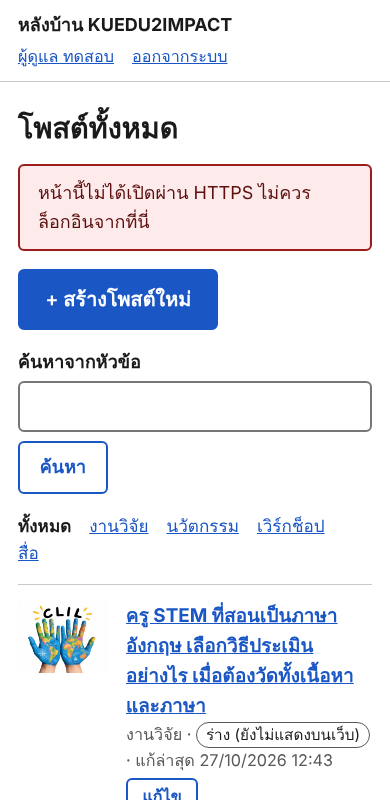
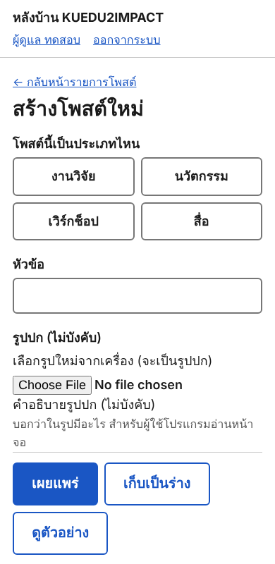
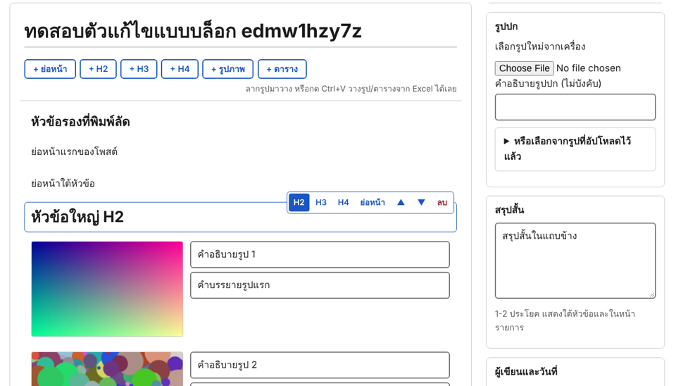
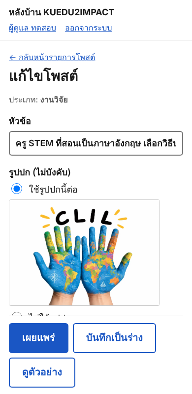
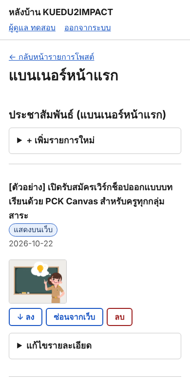

# คู่มือหลังบ้าน

เปิด `https://โดเมนของเว็บ/admin/` แล้วล็อกอินด้วยอีเมลและรหัสผ่าน (ไม่มีปุ่มบนเว็บไปหน้านี้) ทุกอย่างที่บันทึกจะขึ้นบนเว็บทันที

## 1. สร้างโพสต์ใหม่
กดปุ่มสีน้ำเงิน **+ สร้างโพสต์ใหม่** ที่หน้าแรกของหลังบ้าน

## 2. กรอกแล้วกดเผยแพร่
เลือกประเภท พิมพ์หัวข้อ เลือกรูปปก เขียนเนื้อหาในช่องใหญ่ (เว้นหนึ่งบรรทัดว่าง = ขึ้นย่อหน้าใหม่) แล้วกด **เผยแพร่** ถ้ายังไม่พร้อมกด **เก็บเป็นร่าง** (ยังไม่แสดงบนเว็บ) หรือ **ดูตัวอย่าง** ก่อนได้

ใส่รูปในเนื้อหา: เลือกรูปที่ "รูปในเนื้อหา" จะได้ชื่อ `[รูป 1]` กดปุ่ม "แทรกตรงเคอร์เซอร์" หรือพิมพ์ `[รูป 1]` เองในบรรทัดที่ต้องการ

## 3. เขียนเนื้อหา (หัวข้อ รูป ตาราง) และตั้งค่าที่แถบข้าง
หน้าเขียนโพสต์เป็นแผงเดียวแบบ WordPress: ช่องบนสุดคือหัวข้อโพสต์ (H1) ตามด้วยบล็อกเนื้อหา ส่วนข้อมูลเสริมอยู่ที่แถบด้านขวา (บนมือถืออยู่ใต้เนื้อหา)
- **ย่อหน้า:** พิมพ์ได้เลย กด Enter เพื่อขึ้นย่อหน้าใหม่ วางข้อความหลายบรรทัด ระบบแยกเป็นย่อหน้าให้
- **หัวข้อ:** กดปุ่ม + H2 / + H3 / + H4 หรือพิมพ์ `## ` นำหน้าย่อหน้า (`# ` = H2, `## ` = H3, `### ` = H4) หรือกดปุ่ม H2 H3 H4 บนบล็อกเดิมเพื่อเปลี่ยนระดับ
- **รูป:** กด + รูปภาพ (เลือกได้หลายไฟล์พร้อมกัน ไม่จำกัดจำนวน) หรือลากไฟล์มาวาง หรือวางรูปที่คัดลอกไว้ (Ctrl+V) ใส่คำอธิบายรูปใต้รูปทุกรูป (ถ้าเว้นว่าง รูปจะไม่แสดงบนเว็บ)
- **ตาราง:** กด + ตาราง แล้วพิมพ์ในช่อง หรือก็อปตารางจาก Excel / Google Sheets / Word มาวาง หรือลากไฟล์ .csv มาวาง (ไม่เกิน 100 แถว 12 คอลัมน์) ปุ่ม + แถว / + คอลัมน์ เพิ่มช่อง
- เมื่อคลิกบล็อกจะมีแถบเครื่องมือเล็กๆ: เลื่อนขึ้น ▲ ลง ▼ และลบ (ลบแล้วกด “เลิกทำ” ได้) บล็อกใหม่แทรกต่อจากบล็อกที่เลือกอยู่
- ที่แถบข้าง: เผยแพร่ / บันทึกร่าง / ดูตัวอย่าง, ประเภทโพสต์, หมวด, รูปปก, สรุปสั้น, ผู้เขียนและวันที่ และ “ตัวเลือกเพิ่มเติม”
- ถ้าปิดหน้าไปก่อนบันทึก เบราว์เซอร์นี้จะเก็บสิ่งที่พิมพ์ไว้ให้ เปิดโพสต์เดิมอีกครั้งจะมีปุ่ม “กู้คืน”
- **งานวิจัย ↔ นวัตกรรม:** เปลี่ยนที่ “ประเภทโพสต์” แล้วกดบันทึก ลิงก์เก่าพาไปที่ลิงก์ใหม่ให้เอง งานวิจัยใช้หมวดชุดเดียวกับนวัตกรรม (6 หมวด) แต่ไม่แสดงในเมนูและหน้าหมวดของนวัตกรรม
- ถ้าเบราว์เซอร์ปิด JavaScript หน้านี้จะกลับเป็นช่องข้อความแบบเดิม (เว้นบรรทัดว่าง = ย่อหน้า, `# ` `## ` `### ` = หัวข้อ, `[รูป 1]` `[ตาราง 1]` = ตำแหน่งรูปและตาราง)

## 4. แก้ไขหรือซ่อนโพสต์
กดหัวข้อโพสต์ในรายการ แก้แล้วกด **บันทึกการแก้ไข** ถ้าไม่ต้องการให้แสดงกด **ซ่อนจากเว็บ** (ไม่ลบ เลิกทำได้ทันที) ผิดพลาดแล้วอยากกลับไป: เปิด "ดูฉบับก่อนหน้า" ท้ายหน้า

## 5. เรื่องอื่นๆ
ท้ายหน้าแรกมีลิงก์ **จัดการอื่นๆ**: คลังรูป, แบนเนอร์หน้าแรก (ประชาสัมพันธ์และวิดีโอ ใช้ปุ่ม ขึ้น/ลง เรียงลำดับ), ร้านค้า, เครือข่ายวิจัยและความร่วมมือนานาชาติ, วิจัยและนวัตกรรมเพื่อชุมชนและสังคม และสำหรับผู้ดูแลระบบ: ตั้งค่าเว็บ, ผู้ใช้, สำรองข้อมูล (ควรดาวน์โหลดไฟล์สำรองเป็นประจำ)

### เพิ่มเครือข่ายและโครงการบนแผนที่
เมนู **เครือข่าย** บนเว็บมีสองหน้า (ในเมนูและ footer ใช้ชื่อสั้นว่า เครือข่ายวิจัยนานาชาติ และ นวัตกรรมสู่ชุมชน ส่วนหัวข้อของหน้าใช้ชื่อเต็ม) แต่ละหน้ามีรายการของตัวเองในหลังบ้าน (ลิงก์ **เครือข่ายวิจัยและความร่วมมือนานาชาติ** และ **วิจัยและนวัตกรรมเพื่อชุมชนและสังคม** ท้ายหน้าแรกของหลังบ้าน)

- **เครือข่ายวิจัยและความร่วมมือนานาชาติ** (แผนที่โลก): กด **+ เพิ่มสถาบันใหม่** เลือกประเทศ ใส่ชื่อสถาบัน (ชื่อภาษาไทยและเว็บไซต์ไม่บังคับ) เขียนรายละเอียดความร่วมมือ และติ๊กงานวิจัยหรือนวัตกรรมที่เกี่ยวข้องได้ ประเทศหนึ่งเพิ่มได้หลายสถาบัน ประเทศที่มีรายการจะเปลี่ยนเป็นสีม่วงบนแผนที่
- **วิจัยและนวัตกรรมเพื่อชุมชนและสังคม** (แผนที่ประเทศไทย): กด **+ เพิ่มโครงการใหม่** เลือกจังหวัด ใส่ชื่อโครงการ ชุมชนที่ร่วมงาน สรุปสั้นๆ ปี พ.ศ. (เช่น 2568) รูป และติ๊กนวัตกรรมหรือเวิร์กช็อปที่เกี่ยวข้อง จังหวัดหนึ่งเพิ่มได้หลายโครงการ
- **รูปแบบและคุณค่าความร่วมมือ** (ลิงก์ท้ายหน้าแรกของหลังบ้าน): สองแถบข้อความใต้แผนที่โลก คือ รูปแบบความร่วมมือ (การ์ดมีเลขลำดับ) และ คุณค่าที่เกิดกับหลักสูตรและนิสิต กด **+ เพิ่มรายการใหม่** ใส่ข้อความไทย (อังกฤษไม่บังคับ) เลือกไอคอนจากรายการ และเรียงลำดับด้วยปุ่ม ขึ้น/ลง แยกกันในแต่ละแถบ แถบที่ไม่มีรายการแสดงอยู่จะหายไปทั้งแถบ
- **กรอกสถาบันพันธมิตรของหลักสูตรผ่านหน้าเครือข่ายวิจัยนานาชาติ** ใส่ทีละสถาบัน เลือกประเทศแล้วกรอกชื่อสถาบัน: แคนาดา – University of British Columbia, เนเธอร์แลนด์ – University of Groningen, ญี่ปุ่น – Waseda University, ฮ่องกง – The University of Hong Kong, ไต้หวัน – National Taiwan Normal University, เกาหลีใต้ – Seoul National University, ออสเตรเลีย – Curtin University, สิงคโปร์ – MII-STEM Network, National Institute of Education, NTU ส่วนรายละเอียดความร่วมมือให้เขียนเป็นข้อความสั้นๆ ของแต่ละแห่ง (เช่น นิเทศวิทยานิพนธ์ร่วม, วิจัยร่วม, นักวิชาการรับเชิญ) การใส่ชื่ออาจารย์หรือผู้ประสานงานควรทำเมื่อยืนยันข้อมูลและได้รับความยินยอมแล้วเท่านั้น
- ยิ่งมีรายการในประเทศหรือจังหวัดมาก สีบนแผนที่ยิ่งเข้ม (สี่รายการขึ้นไปเข้มที่สุด)
- ปุ่ม **ซ่อนจากเว็บ** ซ่อนรายการโดยไม่ลบ ถ้าซ่อนครบทุกรายการของประเทศหรือจังหวัด พื้นที่นั้นจะกลับเป็นสีเทา
- ถ้าหน้า รูปแบบและคุณค่าความร่วมมือ ขึ้นว่ายังไม่มีตาราง ให้นำเข้า `database/updates/2026-11-06-02-network-highlights.sql` (ต้องนำเข้า 2026-11-06-01-network.sql ก่อน)
- ถ้าเปิดหน้าแล้วขึ้นว่ายังไม่มีตาราง ให้นำเข้าไฟล์ `database/updates/2026-11-06-01-network.sql` ด้วย phpMyAdmin ก่อน (ทำครั้งเดียว)

---

## ติดตั้งครั้งแรก (ทำครั้งเดียว สำหรับผู้ดูแลเว็บ)
1. phpMyAdmin → `e2imedu` → Import → `database/updates/2026-10-27-04-admin.sql` (รันซ้ำได้)
   และ `database/updates/2026-10-28-01-views.sql` (ตัวนับจำนวนการเข้าชม; ผู้ใช้ DB ของเว็บต้องมีสิทธิ์เขียน 3 ตารางนั้น ดูท้ายไฟล์ ถ้าไม่พร้อม หน้าแรกของหลังบ้านจะขึ้นคำเตือนสีแดง)
2. ใน `private/database.php` ใส่ `'setup_token' => 'ข้อความสุ่ม 24 ตัวขึ้นไป'` (และ `admin_user`/`admin_pass` ถ้าสร้างผู้ใช้ DB ตัวที่สอง ดูท้ายไฟล์ 04)
3. อัปโหลดโฟลเดอร์ `admin`, `includes/admin`, `assets/css`, `assets/js` และไฟล์ที่แก้ แล้วลบ `admin/log.php` บนเซิร์ฟเวอร์ (ถ้ามี)
4. เปิด `/admin/setup.php` สร้างผู้ดูแลระบบคนแรก แล้ว **ลบ setup_token ออก** ใช้รหัสผ่านยาว (12 ตัวขึ้นไป) ไม่ซ้ำกับที่อื่น
