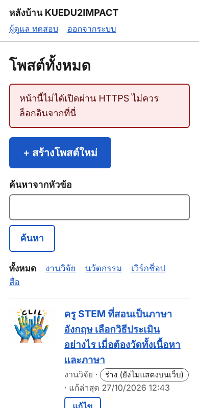
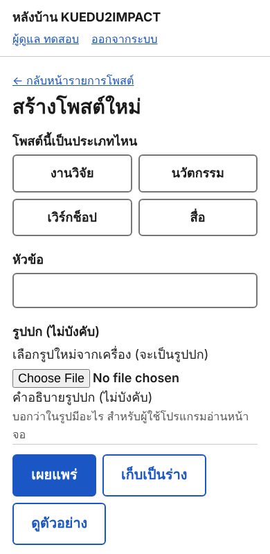
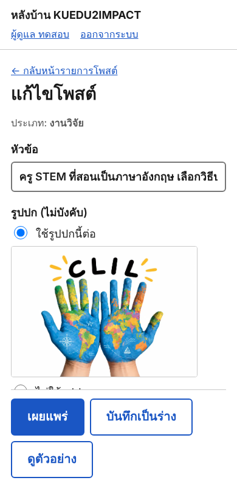
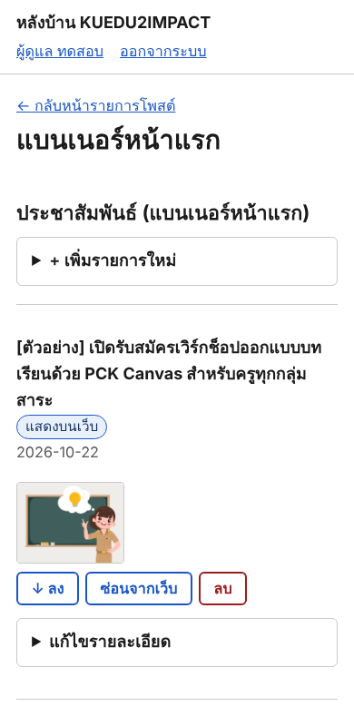

# คู่มือหลังบ้าน

เปิด `https://โดเมนของเว็บ/admin/` แล้วล็อกอินด้วยอีเมลและรหัสผ่าน (ไม่มีปุ่มบนเว็บไปหน้านี้) ทุกอย่างที่บันทึกจะขึ้นบนเว็บทันที

## 1. สร้างโพสต์ใหม่
กดปุ่มสีน้ำเงิน **+ สร้างโพสต์ใหม่** ที่หน้าแรกของหลังบ้าน

## 2. กรอกแล้วกดเผยแพร่
เลือกประเภท พิมพ์หัวข้อ เลือกรูปปก เขียนเนื้อหาในช่องใหญ่ (เว้นหนึ่งบรรทัดว่าง = ขึ้นย่อหน้าใหม่) แล้วกด **เผยแพร่** ถ้ายังไม่พร้อมกด **เก็บเป็นร่าง** (ยังไม่แสดงบนเว็บ) หรือ **ดูตัวอย่าง** ก่อนได้

ใส่รูปในเนื้อหา: เลือกรูปที่ "รูปในเนื้อหา" จะได้ชื่อ `[รูป 1]` กดปุ่ม "แทรกตรงเคอร์เซอร์" หรือพิมพ์ `[รูป 1]` เองในบรรทัดที่ต้องการ

## 3. แก้ไขหรือซ่อนโพสต์
กดหัวข้อโพสต์ในรายการ แก้แล้วกด **บันทึกการแก้ไข** ถ้าไม่ต้องการให้แสดงกด **ซ่อนจากเว็บ** (ไม่ลบ เลิกทำได้ทันที) ผิดพลาดแล้วอยากกลับไป: เปิด "ดูฉบับก่อนหน้า" ท้ายหน้า

## 4. เรื่องอื่นๆ
ท้ายหน้าแรกมีลิงก์ **จัดการอื่นๆ**: คลังรูป, แบนเนอร์หน้าแรก (ประชาสัมพันธ์และวิดีโอ ใช้ปุ่ม ขึ้น/ลง เรียงลำดับ), ร้านค้า และสำหรับผู้ดูแลระบบ: ตั้งค่าเว็บ, ผู้ใช้, สำรองข้อมูล (ควรดาวน์โหลดไฟล์สำรองเป็นประจำ)

---

## ติดตั้งครั้งแรก (ทำครั้งเดียว สำหรับผู้ดูแลเว็บ)
1. phpMyAdmin → `e2imedu` → Import → `database/updates/2026-10-27-04-admin.sql` (รันซ้ำได้)
   และ `database/updates/2026-10-28-01-views.sql` (ตัวนับจำนวนการเข้าชม; ผู้ใช้ DB ของเว็บต้องมีสิทธิ์เขียน 3 ตารางนั้น ดูท้ายไฟล์ ถ้าไม่พร้อม หน้าแรกของหลังบ้านจะขึ้นคำเตือนสีแดง)
2. ใน `private/database.php` ใส่ `'setup_token' => 'ข้อความสุ่ม 24 ตัวขึ้นไป'` (และ `admin_user`/`admin_pass` ถ้าสร้างผู้ใช้ DB ตัวที่สอง ดูท้ายไฟล์ 04)
3. อัปโหลดโฟลเดอร์ `admin`, `includes/admin`, `assets/css`, `assets/js` และไฟล์ที่แก้ แล้วลบ `admin/log.php` บนเซิร์ฟเวอร์ (ถ้ามี)
4. เปิด `/admin/setup.php` สร้างผู้ดูแลระบบคนแรก แล้ว **ลบ setup_token ออก** ใช้รหัสผ่านยาว (12 ตัวขึ้นไป) ไม่ซ้ำกับที่อื่น
